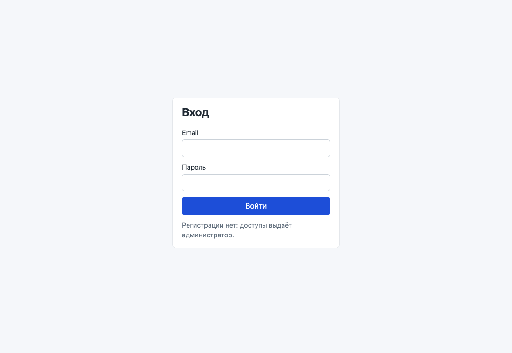
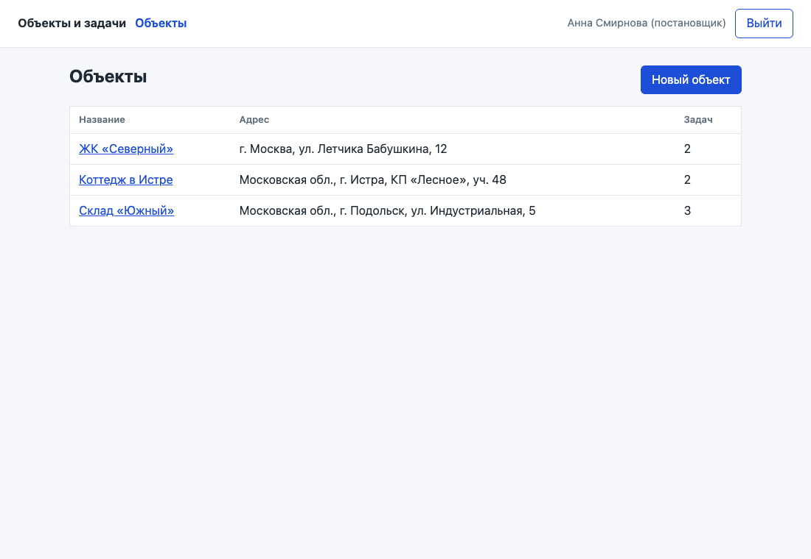
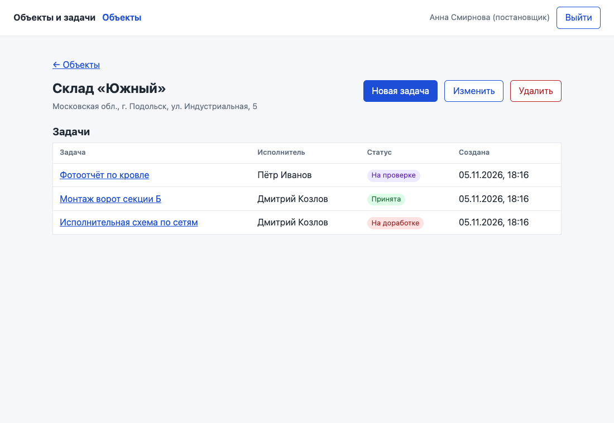
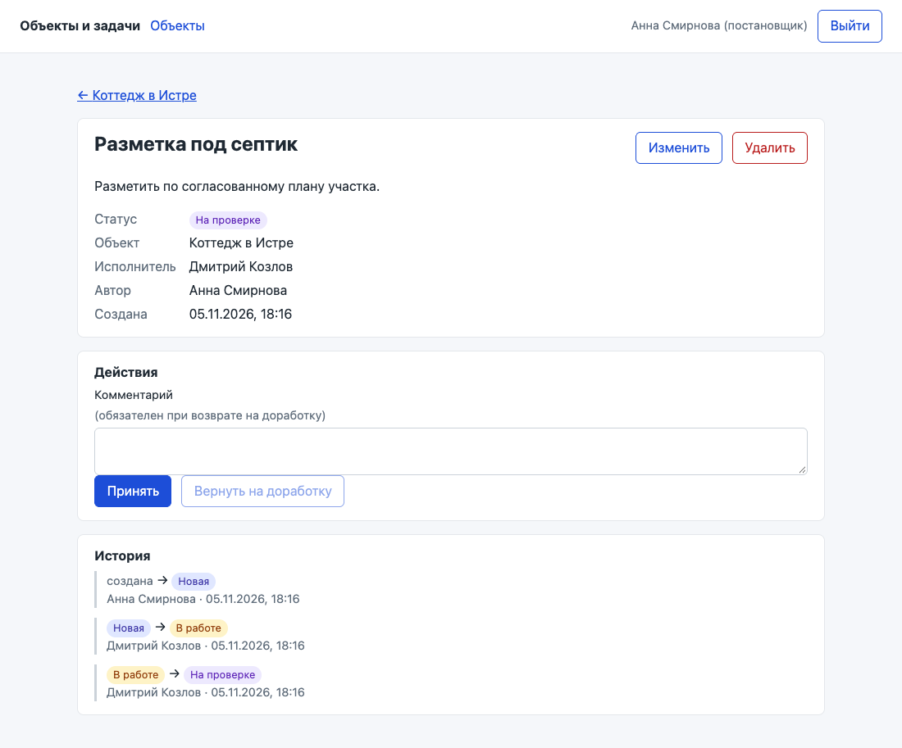
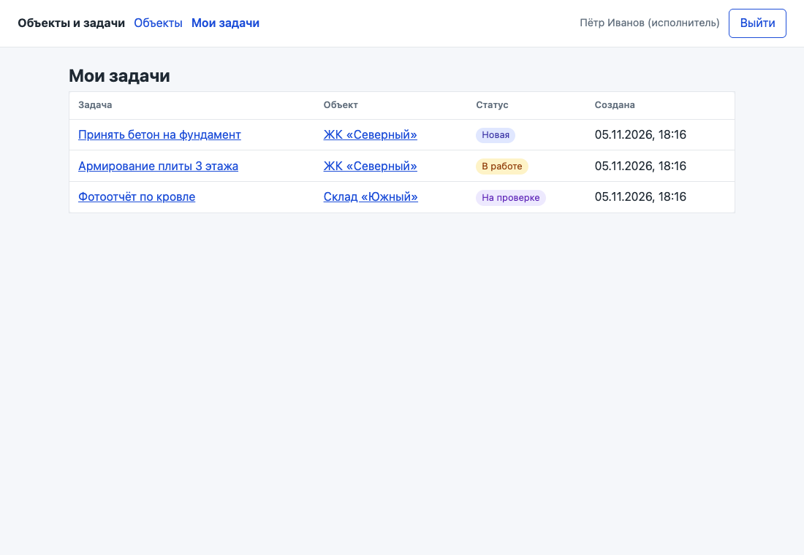
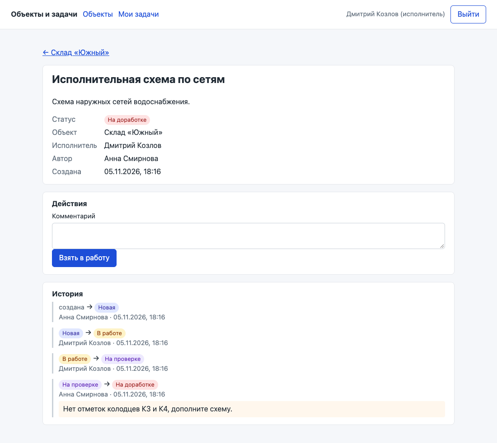

# Объекты и задачи — мини-CRM для стройки

Постановщик ведёт объекты (стройки) и ставит по ним задачи, исполнители берут задачи в работу и отдают на проверку.
Все правила доступа и переходы статусов проверяются в базе Supabase (RLS, триггеры, одна RPC-функция), поэтому работают и при запросах к API в обход интерфейса.

**Стек:** React 19 + TypeScript + Vite, Supabase (Postgres, Auth, PostgREST), TanStack Query, React Router. UI — свой небольшой CSS, без UI-библиотеки.

## Демо-доступы

Приложение: https://yaon1.github.io/kostrov-crm/

| Роль | Email | Пароль |
|---|---|---|
| Постановщик | manager@example.com | Demo-2026! |
| Исполнитель | executor1@example.com | Demo-2026! |
| Исполнитель | executor2@example.com | Demo-2026! |

В демо-данных 3 объекта и 7 задач во всех пяти статусах (`supabase/seed.sql`).

## Скриншоты

| | |
|---|---|
|  Вход по email и паролю |  Список объектов (постановщик) |
|  Карточка объекта с задачами |  Задача на проверке: постановщику доступны «Принять» и «Вернуть на доработку» (только с комментарием) |
|  «Мои задачи» исполнителя |  Задача на доработке у исполнителя: комментарий в истории, доступно «Взять в работу» |

## Запуск локально

Нужны Node.js 20+ и Docker (для локального Supabase).

```bash
npm install
npx supabase start          # поднимает Postgres/Auth/API, применяет миграции и seed
cp .env.example .env        # вписать API URL и anon key из `npx supabase status`
npm run dev                 # http://127.0.0.1:5173
```

Пересоздать базу с нуля: `npx supabase db reset`.

## Развёртывание в облаке

1. Создать проект Supabase (бесплатный тариф).
2. **Authentication → Sign In / Providers → выключить «Allow new users to sign up».**
3. Применить миграции: `npx supabase link --project-ref <ref> && npx supabase db push`
   (или выполнить `supabase/migrations/*.sql` в SQL Editor).
4. Демо-данные: выполнить `supabase/seed.sql` в SQL Editor.
   Свои пользователи — Authentication → Users → Add user; роль постановщика:
   `update public.profiles set role = 'manager' where id = '<user id>';`
5. Фронтенд: демо собирается и выкладывается на GitHub Pages workflow-ом `.github/workflows/pages.yml` (переменные репозитория `VITE_SUPABASE_URL` и `VITE_SUPABASE_ANON_KEY`). Подойдут и Vercel / Netlify: сборка `npm run build`, каталог `dist`, те же переменные; для SPA-маршрутов в Vercel лежит `vercel.json`.

Во фронтенд попадает только публичный anon-ключ. Ключ `service_role` нигде в проекте не используется; `.env` в `.gitignore`.

## Проверки

```bash
npm run build      # типы + сборка
npm run lint       # oxlint
npm run test:db    # правила доступа на уровне SQL (PGlite, Docker не нужен)
npm run test:api   # те же правила через настоящий Supabase API (нужен npx supabase start и .env)
```

`test:db` поднимает Postgres в памяти, применяет миграции и seed и от имени разных пользователей пытается сделать запрещённое: прочитать чужое, сменить статус напрямую, подделать историю, повысить себе роль.

## Схема базы

| Таблица | Что хранит |
|---|---|
| `profiles` | пользователь и его роль (`manager` — постановщик, `executor` — исполнитель); создаётся триггером при создании пользователя в Auth |
| `sites` | объекты: название, адрес |
| `tasks` | задачи: название, описание, объект, исполнитель, статус, автор, дата создания |
| `status_transitions` | справочник разрешённых переходов: откуда, куда, кто (постановщик / назначенный исполнитель), нужен ли комментарий |
| `task_status_history` | история смен статусов: кто, когда, из какого в какой, комментарий |

Статусы: `new` Новая → `in_progress` В работе → `review` На проверке → `accepted` Принята / `rework` На доработке → `in_progress`.

## Как защищены данные

| Что | Постановщик | Исполнитель |
|---|---|---|
| Объекты | читает, создаёт, меняет, удаляет все | читает только объекты, где у него есть задачи |
| Задачи | читает, создаёт, меняет, удаляет все | читает только свои; напрямую менять не может |
| Смена статуса | принять / вернуть на доработку (с комментарием) | взять в работу, отправить на проверку — только в своих задачах |
| История | читает | читает по своим задачам |
| Профили | видит всех | видит себя и постановщиков |

Механизмы:

- **RLS** включён на всех таблицах; анонимному ключу доступ к данным закрыт полностью.
- **Смена статуса только через `change_task_status(task_id, status, comment)`.** Функция берёт правило из `status_transitions`, проверяет роль и назначение, обязательный комментарий, меняет статус и пишет историю в одной транзакции. Прямой `UPDATE tasks SET status` из API отклоняется триггером — даже у постановщика.
- **При создании задачи** база сама ставит статус «Новая», автора = текущий пользователь и дату; пишет первую запись истории. Подставить другие значения из запроса нельзя. Исполнителем можно назначить только пользователя с ролью исполнителя.
- **История только для чтения:** права `INSERT/UPDATE/DELETE` у API-ролей отозваны, записи делает только сервер.
- **Роль нельзя повысить себе:** `profiles` через API только читается; роль задаётся из `app_metadata` (её не может поменять сам пользователь) или администратором через SQL.
- **Регистрация выключена** (`enable_signup = false` в `supabase/config.toml`, в облаке — настройка проекта).
- Интерфейс берёт правила переходов из той же таблицы `status_transitions` и показывает только доступные кнопки; но защита от этого не зависит.

## Для руководителя: как это устроено (без терминов)

В системе два типа сотрудников. **Постановщик** заводит стройки, ставит по ним задачи и назначает исполнителя. **Исполнитель** заходит под своим логином и видит только свои задачи и только те стройки, где они у него есть: чужие задачи для него как будто не существуют.

Задача проходит фиксированный путь: «Новая» → исполнитель берёт «В работу» → отправляет «На проверку» → постановщик «Принимает» или «Возвращает на доработку», и тогда обязан написать, что исправить. Перепрыгнуть шаг нельзя. Каждый шаг записывается в историю: кто, когда и с каким комментарием. Историю никто не может исправить или удалить задним числом.

Главное: эти правила проверяет сама база данных, а не только экран приложения. Даже если сотрудник разбирается в программировании и попробует отправить запрос «мимо» приложения, база его не пропустит.

**Исполнитель не может:** увидеть чужие задачи и стройки; создать, переименовать или удалить задачу; сам принять свою работу или вернуть её; перескочить через этап; поменять или удалить историю; выдать себе права постановщика; зарегистрироваться сам — логины выдаёт администратор.

## Решения и допущения

- Исполнитель обязателен при создании задачи и может быть только пользователем с ролью «исполнитель».
- Постановщик может редактировать название, описание, объект и исполнителя в любом статусе. Статус меняется только по циклу.
- При переназначении задача пропадает у прежнего исполнителя и появляется у нового вместе со всей историей.
- Удаление задачи удаляет и её историю (история принадлежит задаче). Объект с задачами удалить нельзя — сначала удалить или перенести задачи.
- Комментарий можно оставить при любом переходе, обязателен — только при возврате на доработку.
- Исполнитель видит профили только свои и постановщиков (нужны для «автор» и истории); список коллег-исполнителей ему не виден.
- «Мои задачи» — экран исполнителя; постановщик работает через объекты.
- Роль задаётся при создании пользователя (`app_metadata.app_role`) или SQL-запросом; экрана управления пользователями нет — по ТЗ пользователи создаются вручную.

## Что не сделано

- Пагинация и поиск по спискам — на объёме тестового не нужны.
- Обновление в реальном времени (Supabase Realtime): данные обновляются после действий и при переходах между экранами.
- Тесты интерфейса: проверена логика базы (`test:db`, `test:api`), экраны проверены вручную.

## Структура

```
supabase/
  migrations/      схема, триггеры, RPC, RLS
  seed.sql         демо-пользователи и данные
src/
  api/             запросы к Supabase (TanStack Query)
  auth/            сессия и профиль текущего пользователя
  components/      формы, действия по задаче, история
  pages/           экраны: вход, объекты, объект, задача, мои задачи
  lib/             клиент Supabase, подписи статусов, правила кнопок
  types/           типы схемы базы
tests/
  db/              проверка правил доступа в Postgres (PGlite)
  api/             проверка через Supabase API
```

Автор: Сергей Аринин, [github.com/yaon1](https://github.com/yaon1)
